# Optimal HRV Web Dashboard

The Optimal HRV Web Dashboard at [app.optimalhrv.com](https://app.optimalhrv.com) is where coaches, clinicians, and managers bring people into an organization, organize them into groups, follow their HRV and biofeedback practice, and manage billing.

> **Note:** This guide covers the **Professional** workspace, which has the organization and group tools. Your own readings and sessions are in the **Personal** workspace, which isn't covered here.

---

## 🚀 1: Getting Started

### Sign In

1. Go to [app.optimalhrv.com](https://app.optimalhrv.com).
2. Sign in with **Google**, **Apple**, or your **email and password**. Use the same account you use in the Optimal HRV mobile app.
3. If you forget your password, click **Forgot password?** on the sign-in page.

> **Tip:** Tick **Remember me** on a computer you trust so you stay signed in.

### Switch to the Professional Workspace

Every dashboard account has two workspaces. You can switch between them with the toggle at the bottom of the left sidebar:

- **Personal:** Your own readings, biofeedback, mindfulness, and RF assessments.
- **Professional:** The tools for your organization and groups. Everything in this guide is here.

Click **Professional** to open the organization dashboard. The label above the toggle shows your current role, for example _Workspace · Organization admin_.

### Get Set Up Checklist

When you first open the Professional workspace, a **Get Optimal HRV set up** card at the top of the dashboard walks you through five steps:

1. **Take the dashboard tour**
2. **Create your first group**
3. **Add members with a QR code or link**
4. **Approve anyone waiting to join**
5. **Open one member's page**

Click **All steps** to see the list, then click the button next to any step to jump straight to it. You can replay the tours whenever you like from the **Help and tours** (?) button in the top bar.

### Find Your Way Around

**Left sidebar (Professional workspace):**

| Menu item | What it's for |
| --- | --- |
| **Dashboard** | Organization overview: practice summary, member list, group health, and who needs a check-in |
| **Manage groups** | Create, open, edit, and delete groups |
| **Manage members** | Search, add, edit, and remove members |
| **Add member** | Shortcut that opens the **Add members** panel from any page |
| **Join Requests** | Approve or decline people who joined with a QR code or join link |
| **Reports & Analytics** | Readings and biofeedback analytics by group or member, plus data export |
| **Connections** | The organizations you belong to, your role in each, and **Create organization** |
| **Notifications** | Membership, health, inactivity, and clinical alerts |
| **Invoices** | Your organization's invoices: pay them or download PDFs |
| **Billing** | Rate, active members, estimated charge, payment cards, and billing email |
| **Settings** | Your profile, sign-in, and display preferences |

**Top bar:**

- **Organization context** (next to the back arrow): Shows which organization you're working in and your role. Click it to switch organizations (see [Switch Organizations](#switch-organizations)).
- **Search** (⌘K / Ctrl+K): Find members, organizations, and groups quickly.
- **Help and tours** (?): Replay the guided tours.
- **Notifications** (bell), **Dark mode** toggle, and your **account menu**.

<div align=center>
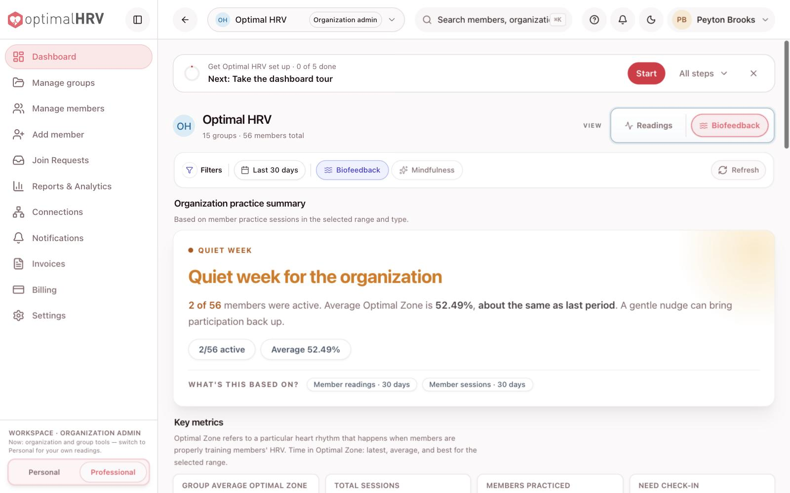
</div>

### Roles and What They Can Do

When you add someone or edit their role, you choose one of these roles:

| Role | What they can do | Can see health data? |
| --- | --- | --- |
| **Owner** | Owns the organization and has full access, including giving people admin-level roles | Yes |
| **Organization admin** | Manages all members, groups, billing, and settings in the organization | Yes |
| **Organization manager** | Manages people, groups, and billing | **No** |
| **Group admin** | Manages their group and can view its members' health data | Yes (own group) |
| **Group manager** | Manages the members of their group | **No** |
| **Member** | Takes readings and practices in the app. Has no admin tools. | Only their own |

> **Note:** You can only give someone a role below your own. For example, an Organization admin can't make another person an Organization admin. If you need to give someone a role at your level, ask your organization **Owner**. The form shows this reminder as _"Need a peer role for someone? Ask your organization owner."_

---

<div align=center>
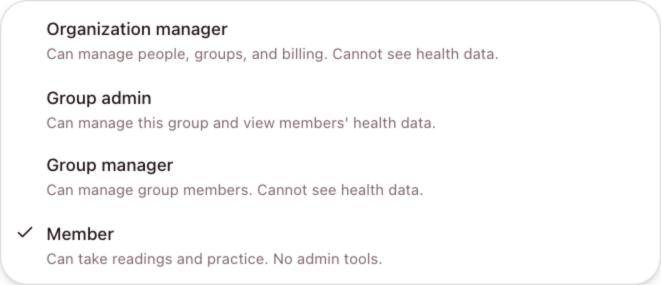
</div>

## 👥 2: Adding Members

**Who can do this:** Owners, Organization admins and managers, Group admins and managers (for their own groups)

To add members, open **Manage members** and click **Add members** (top right), or click **Add member** in the sidebar. The **Add members** panel offers three ways to add people:

<div align=center>
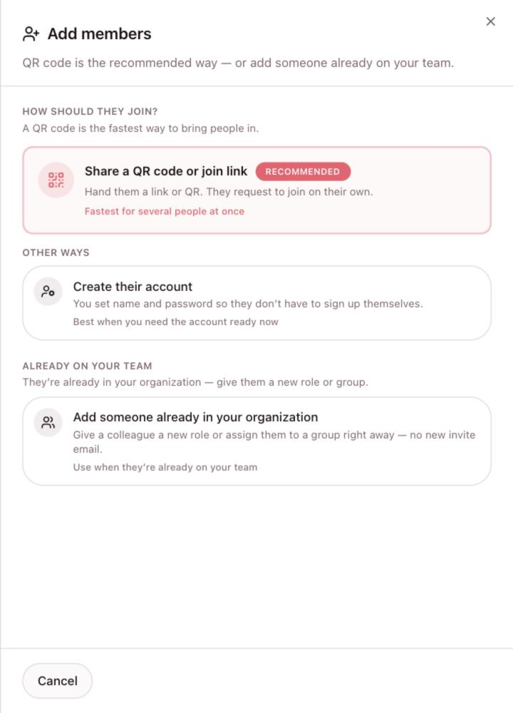
</div>

| Option | Best for |
| --- | --- |
| **Share a QR code or join link** ⭐ _Recommended_ | Adding several people at once. They scan or open the link and ask to join. |
| **Create their account** | When the account needs to be ready right away. You set the name and a temporary password. |
| **Add someone already in your organization** | Giving an existing member a new role or adding them to another group. No invite email is sent. |

### Option 1: Share a QR Code or Join Link (Recommended)

This is the fastest way to add a class, team, or client list. You create a code, share it, and people request to join on their own.

**How joining works:**

- **Approval is on by default.** People wait in **Join Requests** until you approve them.
- **You choose who pays:** your organization, or each member.
- **Codes never expire** unless you set an expiration date.
- **You can revoke a code at any time.** People who already joined stay in the organization.

<div align=center>
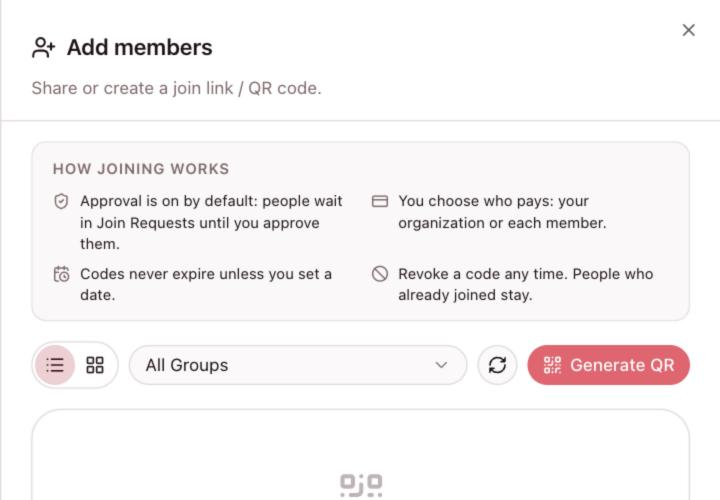
</div>

#### Create a Join Link / QR Code

1. Go to **Manage members** → **Add members** → **Share a QR code or join link**.
2. Click **Generate QR** (or **Generate QR Code** if you haven't created any yet).
3. Fill in the form:
   - **Label (optional):** A name to help you recognize the code later, for example _"Front desk flyer"_.
   - **Groups \*:** Pick one or more groups. Each group gets its own join link and QR code with the same settings.
   - **Who pays for the subscription?** Choose **Organization pays** or **Member pays**. You can change this later from the member's profile.
   - **Require approval to join:** When this is **on**, people wait for you to approve them. When it's **off**, they join right away.
   - **Custom expiration:** Leave it **off** so the code never expires, or turn it on and choose an end date.
4. Click **Generate QR Code**.

<div align=center>
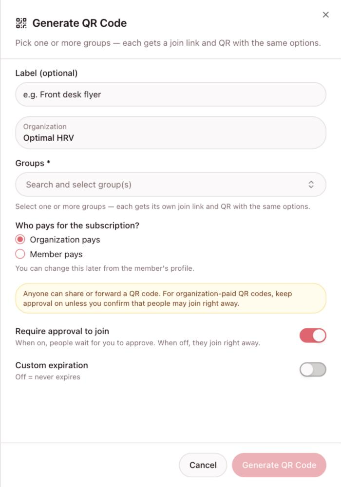
</div>

> **⚠️ Important:** Anyone can share or forward a QR code. If your **organization pays**, keep **Require approval to join** turned on. Otherwise anyone who gets the code can join and be billed to your organization.

#### Share and Manage Your Codes

Every code you create is listed in the **Share a QR code or join link** panel. For each code you can:

- **Copy** the join link to send by email, text, or chat
- **Print** or display the QR code, for example on a flyer, a slide, or the front desk
- **Revoke** the code when you no longer need it

Use the **All Groups** filter to see the codes for one group, and switch between the list and grid views with the icons next to it.

#### Approve Join Requests

When someone scans your QR code or opens your join link, their request appears on **Join Requests** (when approval is required).

1. Open **Join Requests** from the sidebar.
2. Check the **Pending** count at the top. For each request, the table shows the **Requester**, **Group**, **Source**, **Payer**, **Message**, **Reason**, **Status**, and **Submitted** date.
3. **Approve** the people you recognize and **Decline** requests that don't belong.

Use the **All Status**, **All Sources**, and **All Groups** filters to narrow the list. You'll also get a **Membership** alert on the **Notifications** page when someone is waiting.

<div align=center>
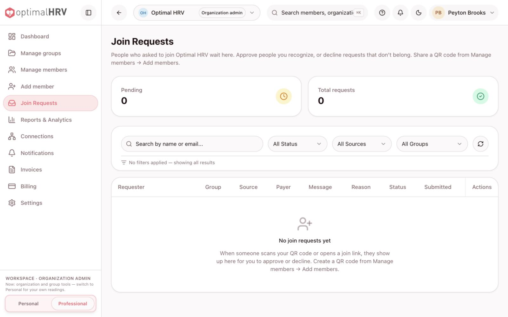
</div>

### Option 2: Create Their Account

Use this when you want the account to be ready immediately, for example to set someone up during an appointment.

1. Go to **Manage members** → **Add members** → **Create their account**.
2. Fill in the form:
   - **First name \*** and **Last name \***
   - **Email \*:** This is the address they'll use to sign in.
   - **Temporary password \*:** A secure password is filled in for you. Use the 👁 icon to show it, the **copy** button to copy it, or the **refresh** button to generate a new one.
   - **Gender** (optional)
   - **Role \*:** Usually **Member**. See [Roles and What They Can Do](#roles-and-what-they-can-do).
   - **Group(s) \*:** One or more groups the person will belong to.
   - **Who pays for the subscription?** **Organization pays** or **Member pays**.
3. Click **Create account**.

<div align=center>
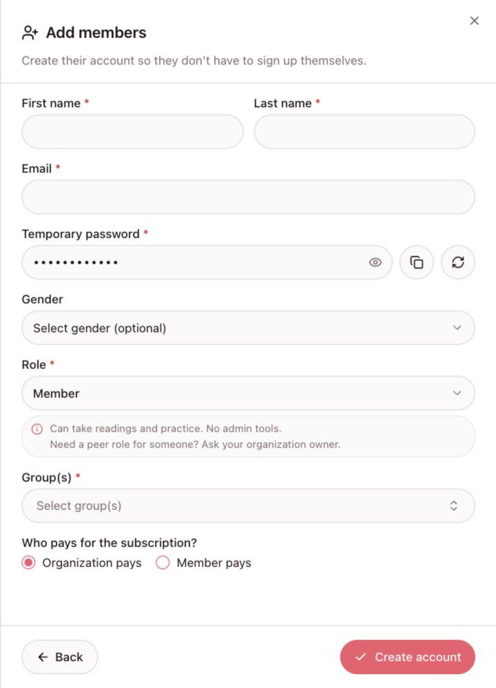
</div>

#### After Creating the Account

1. **Share the login details securely.** Send the person their email address and temporary password.
2. **Ask them to:**
   - Install the Optimal HRV app ([iOS](https://apps.apple.com/us/app/optimal-hrv/id1501292206) / [Android](https://play.google.com/store/apps/details?id=com.optimalhrv.app&hl=en_US&gl=US)) and sign in.
   - Change their password, and fill in their date of birth and gender in their profile. These are used to calculate population norms.

> **Already has an account?** If the email is already registered with Optimal HRV, you can't create a new account for it. Send that person a **QR code or join link** instead so they can join with their existing account.

### Option 3: Add Someone Already in Your Organization

Use this to give an existing member a new role (for example, making them a Group admin) or to add them to another group. No new invite email is sent.

1. Go to **Manage members** → **Add members** → **Add someone already in your organization**.
2. **Person \*:** Search for and select the member.
3. **Role \*:** Choose their role.
4. **Group(s) \*:** Choose the groups to add them to.
5. Click **Add member**.

---

<div align=center>
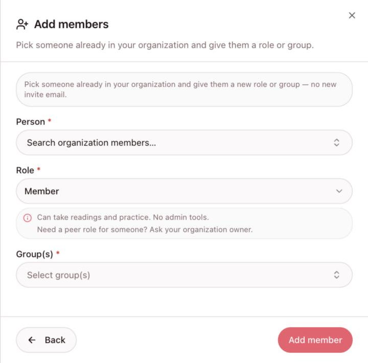
</div>

## 🧑‍🤝‍🧑 3: Managing Members

### The Manage Members Page

**Manage members** lists everyone in the current organization. It has these columns:

| Column | Description |
| --- | --- |
| **Member** | Name and email. Click it to open the member's profile. |
| **Last Active** | When they last used the app |
| **Role** | Their role, for example Member, Group admin, or Organization admin |
| **Health** | Their recent HRV (RMSSD) and trend compared with their own average, for example _On track_, _Improving_, _Inactive_, or _Never active_ |
| **Status** | Whether the account is active |
| **Actions** | The **⋯** menu: **View Profile**, **Edit**, **Remove from organization** |

**To find people:**

- Type in **Search by name or email…**
- Filter by group (**All Groups**), by activity date (**Last active**), or by role (**All Roles**)
- Click a column header to sort by it
- Change how many people you see per page with **Rows** at the bottom

<div align=center>
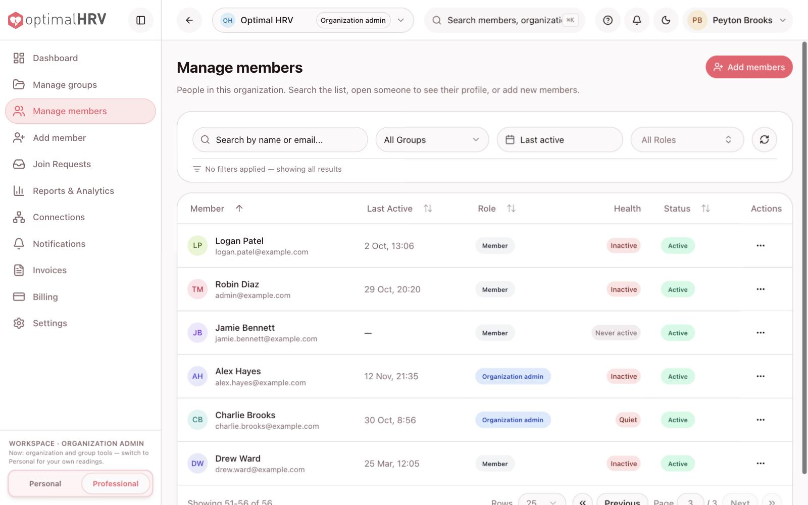
</div>

### Edit a Member

1. On **Manage members**, click **⋯** at the end of the member's row → **Edit**.
2. The **Edit Member** panel has three tabs:
   - **Basic:** First name, last name, email, phone, and date of birth.
   - **Assign:** Group(s), role, and **Who pays for the subscription?** (Organization pays / Member pays)
   - **Prof.:** Professional details (title, credentials, specialization, bio). You edit these on the member's profile page, not in this panel.
3. Click **Next** to go between the tabs, then click **Save Changes**.

<div align=center>
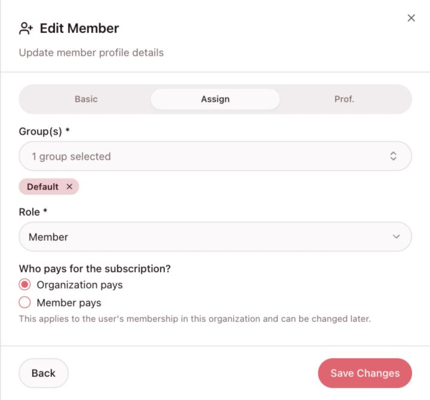
</div>

### Move a Member to Another Group or Change Their Role

You can do this in either of two ways:

- **Edit** the member (see above) and change **Group(s)** or **Role** on the **Assign** tab, **or**
- Use **Add members** → **Add someone already in your organization**.

> **Tip:** A member only shows up in a group's dashboards and reports once they've been added to that group.

### Change Who Pays for a Member

1. Click **⋯** → **Edit** → **Assign** tab.
2. Under **Who pays for the subscription?**, choose **Organization pays** or **Member pays**.
3. Click **Save Changes**.

Members set to **Organization pays** are billed to your organization (see [Billing](#💳-6-billing-and-invoices)).

### Remove a Member

1. Click **⋯** at the end of the member's row → **Remove from organization**.
2. Confirm.

They're removed from your organization and its groups, so they no longer appear in its dashboards and reports.

### View a Member's Profile

Click a member's name, or **⋯** → **View Profile**. The profile shows:

- **Header:** Name, roles, status, email, total counts (readings, biofeedback, mindfulness, RF assessments), last sign-in, and last activity
- **Tabs:**
  - **Readings:** Morning and anytime HRV readings and their trends
  - **Biofeedback:** Optimal Zone summary, key metrics (Optimal Zone, Training Efficiency, Low Frequency, Max–Min), time in each zone, session length mix, practice streak, and **Session history**
  - **Mindfulness:** Mindfulness sessions
  - **RF assessment:** Resonance frequency assessment results
  - **Profile:** Personal and professional details
- **Filters:** Change the date range (for example **Last 30 days**) and click **Refresh**.
- **Export:** Download the member's RRI data (see [Export Data](#export-data)).

---

<div align=center>
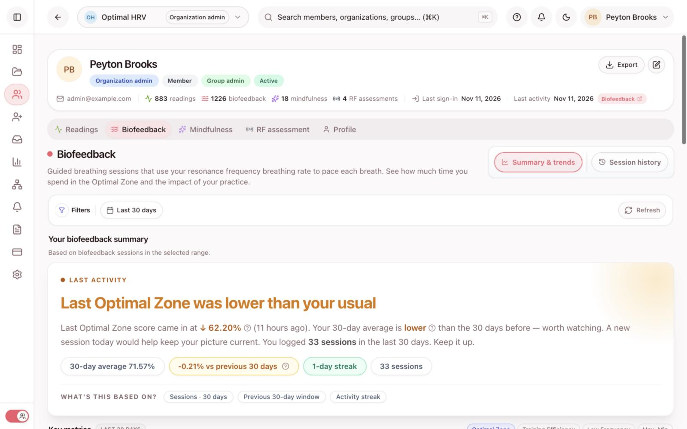
</div>

## 🗂 4: Managing Groups

**Who can do this:** Owners and Organization admins/managers can create groups and manage all of them. Group admins and managers can only manage their own groups.

Groups keep people organized inside your organization, for example by department, class, cohort, or client program. Every organization has a **Default** group.

### The Groups Page

**Manage groups** lists every group in the organization, with these columns: **Group**, **Type**, **Members**, **Active · 7 days**, **Health** (average RMSSD compared with the group's usual), **Created**, and **Actions**. Use **Search groups…** and **All Types** to filter the list.

<div align=center>
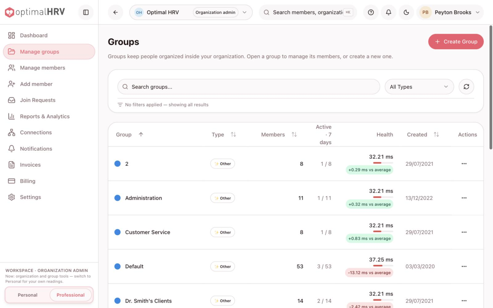
</div>

### Create a Group

1. Go to **Manage groups** and click **Create Group**.
2. On the **Details** tab, fill in:
   - **Group name \***, for example _"Cardiac Rehabilitation"_
   - **Group type \*:** Therapy, Support Group, Coaching, Wellness Program, Class, Cohort, Training, Team, Department, Research Study, or Other
   - **Description** (optional)
   - **Group color:** Used to tell groups apart in charts and lists
   - **Private group:** Turn this on so only the group's members can see the group
3. Click **Create Group**.
4. The **Members** tab unlocks once the group exists. Use it to add people right away, or add them later with [Add members](#👥-2-adding-members).

<div align=center>
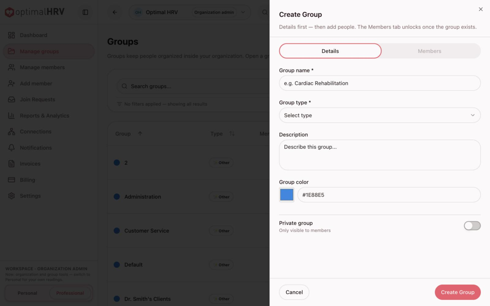
</div>

### Open and Manage a Group

Click a group's name to open it. The group page has these tabs:

| Tab | What you'll find |
| --- | --- |
| **Overview** | Group practice summary, all members with their trends and streaks, and **Member follow-up** |
| **Readings** | HRV readings analytics for the group |
| **Biofeedback** | Biofeedback and mindfulness analytics for the group |
| **Users** | The group's member list. Click **Add members** to add people directly to this group. |
| **Settings** | **Private group** and **Require approval** (an admin must approve new members), plus **Delete group** |

Click **Edit** next to the group name to rename it or change its type, description, or color.

<div align=center>
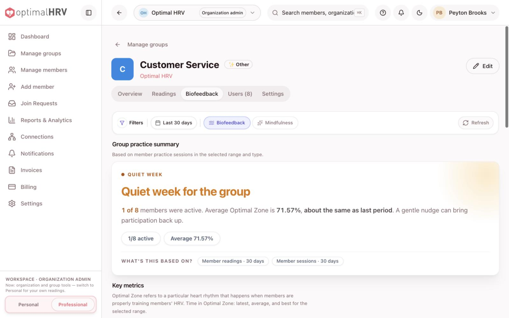
</div>

### Delete a Group

Open the group → **Settings** tab → **Delete group**, then confirm. Before you delete a group, move anyone you still want to follow into another group.

---

## 📈 5: Following Your Members' Progress

### Organization Dashboard

**Dashboard** (Professional workspace) shows your whole organization at a glance:

- **View:** Switch between **Readings** (HRV readings) and **Biofeedback** (biofeedback and mindfulness practice).
- **Filters:** Choose a date range (for example **Last 30 days**) and session types (**Biofeedback**, **Mindfulness**), then click **Refresh**.
- **Practice summary:** A short summary of the period in plain language, for example _"Quiet week for the organization — 2 of 56 members were active"_. Expand **What's this based on?** to see the data behind it.
- **Key metrics:** Optimal Zone time (latest, average, and best) in the Biofeedback view, or RMSSD in the Readings view.
- **All members:** Each member's trend compared with their own usual, their streak, last activity, and status (**On Track**, **Improving**, **Inactive**, **Never Active**). Click **View →** to open a member's profile.
- **How each group is doing:** One card per group with its average and how many members are active. Click a card to filter the page to that group.
- **Who's been active:** How many members opened the app each week.

### Member Follow-Up: Who Needs a Check-In

The **Member follow-up** section on the dashboard, on group pages, and in Reports shows who may need your attention this week:

| Bucket | Meaning |
| --- | --- |
| **Below their usual** | Still practicing, but their Optimal Zone time this period is more than 15% below their usual. The biggest drops are listed first. |
| **Gone quiet** | Practiced before, then stopped in the last 30 days. The most recent stops are listed first. |
| **Long quiet** | No practice for 30 days or more. These people aren't counted in _Need check-in_. |
| **Never started** | Joined or were invited, but haven't had a session yet. |

Click **Show list** on a bucket to see everyone in it.

<div align=center>
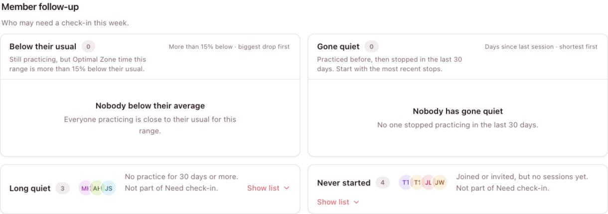
</div>

### Reports & Analytics

**Reports & Analytics** is the deeper view, for the whole organization, a group, or a single person.

1. **Choose a view:** **Readings** or **Biofeedback**.
2. **Narrow the scope:** Use **Groups** and **Members** to focus on specific groups or people.
3. **Set filters:**
   - **Date range:** for example **Last 30 days**
   - **Readings view:** **Morning**, **Anytime**, and **Tags**
   - **Biofeedback view:** **Biofeedback** and **Mindfulness**
4. Review the results:
   - **Readings:** Group average RMSSD, members improving (RMSSD above their own average), members active, and members who need a check-in
   - **Biofeedback:** Group average Optimal Zone time, total sessions, members who practiced, and members who need a check-in
   - Member list, member follow-up, and group cards, as on the Dashboard

<div align=center>
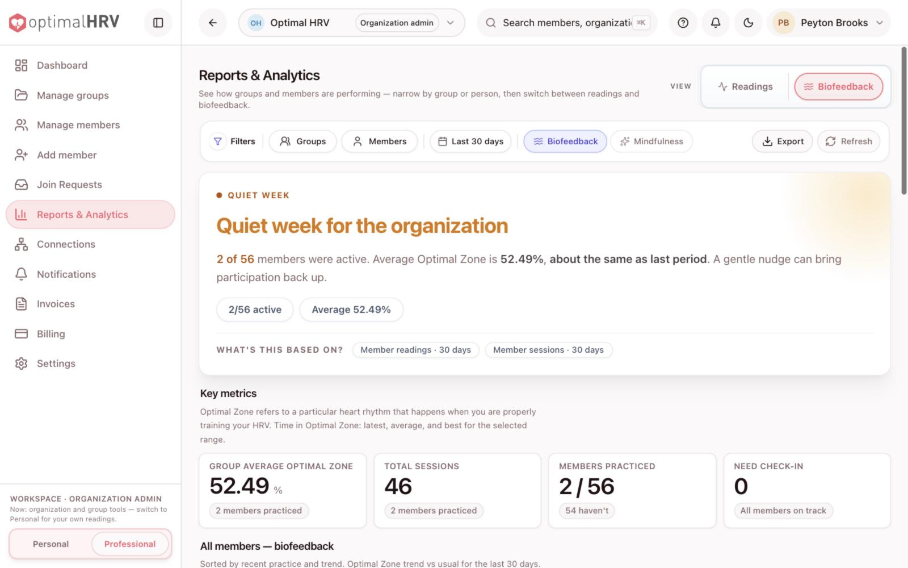
</div>

#### Key Metrics Explained

- **Optimal Zone:** The share of a biofeedback session spent in the heart rhythm that shows effective HRV training. Sessions are split into **Optimal Zone**, **Medium**, and **Low**.
- **RMSSD:** Root Mean Square of Successive Differences, the main time-domain HRV measure used in readings.
- **Training Efficiency, Low Frequency, Max–Min:** Other biofeedback metrics you can switch to in **Key metrics**.

### Export Data

You can download raw **RRI (RR interval) data** for analysis in any HRV tool (for example Kubios, R, or Python).

- **For a whole organization, group, or filtered list:** On **Reports & Analytics**, click **Export**. This exports everyone currently in scope (up to 50 members).
- **For one member:** On the member's profile, click **Export**.
- **For your own data:** Go to **Settings** → **Account** → **Export my data**.

**Steps:**

1. Under **What to export**, choose the activities: **Readings**, **Biofeedback**, **Mindfulness**, and/or **RF assessments**.
2. Choose a **Date range**.
3. Check the summary (who is included, activity types, and the date range in UTC), then click **Start export**.

<div align=center>
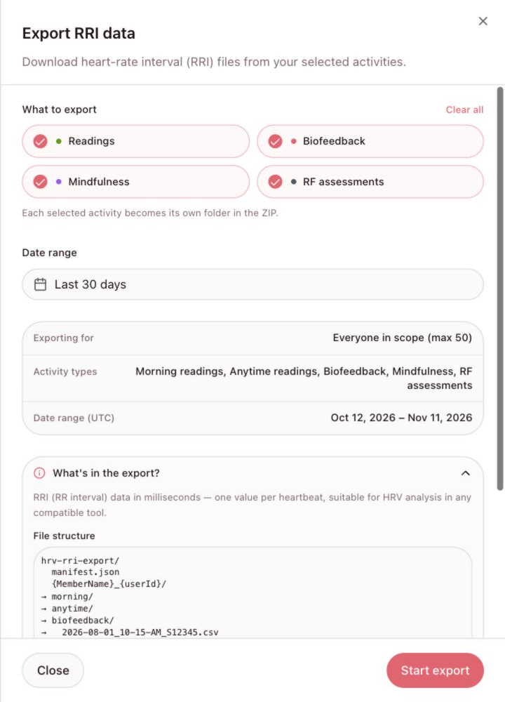
</div>

**What you get:** A ZIP file with one folder per member and one subfolder per activity:

```
hrv-rri-export/
  manifest.json
  {MemberName}_{userId}/
    morning/
    anytime/
    biofeedback/
      2026-08-01_10-15-AM_S12345.csv
    mindfulness/
    rf-assessment/
```

- Each CSV has a single **RR** column, with one value per heartbeat in milliseconds.
- File names use UTC times and include the reading ID (`R…`) or session ID (`S…`).
- Activities without RRI data are listed as skipped in `manifest.json`.

---

## 💳 6: Billing and Invoices

**Who can do this:** Owners, Organization admins, and Organization managers. Group admins and managers can't see billing.

### How Billing Works

Organizations are billed **$4.99 per active member per month**. There are no seat packs or prepaid tiers. Your **Billing** page always lists exactly which members are counted in the current period. Members set to **Member pays** pay for their own subscription.

### The Billing Page

Open **Billing** from the sidebar to see:

- **Rate:** $4.99 per active member per month
- **Active members:** How many members count toward the current billing period, and the period's dates
- **Estimated charge:** For example _3 × $4.99 = $14.97_
- **Billing day:** The day of the month invoices are created, and the date of the next invoice
- **Billing email:** Where receipts and invoices are sent. Click **Change** to update it.
- **Active members this period:** Exactly who is being billed for, with their name, email, and a **View** link to their profile. No health data is shown here.

<div align=center>
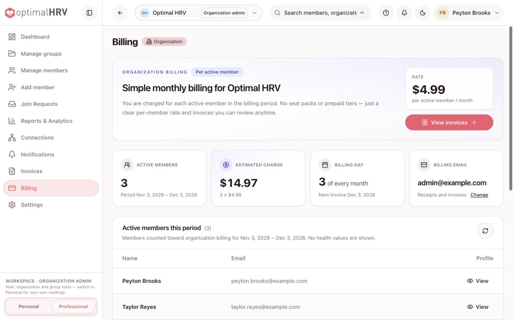
</div>

### Add a Payment Card

1. On **Billing**, under **Payment methods**, click **Add card** (or **Add your first card**).
2. Enter the card details and save.

With a card on file, invoices are paid automatically. Without one, you can pay each invoice yourself from the **Invoices** page.

### Invoices

Open **Invoices** from the sidebar to see your organization's billing history:

| Column | Description |
| --- | --- |
| **Invoice** | Invoice number |
| **Date** | Invoice date |
| **Amount** | Total billed |
| **Status** | For example **Pending** or **Paid** |
| **Action** | **Pay** an open invoice, or download it as a **PDF** |

Use **All Status** and **Date range** to filter the list.

---

<div align=center>
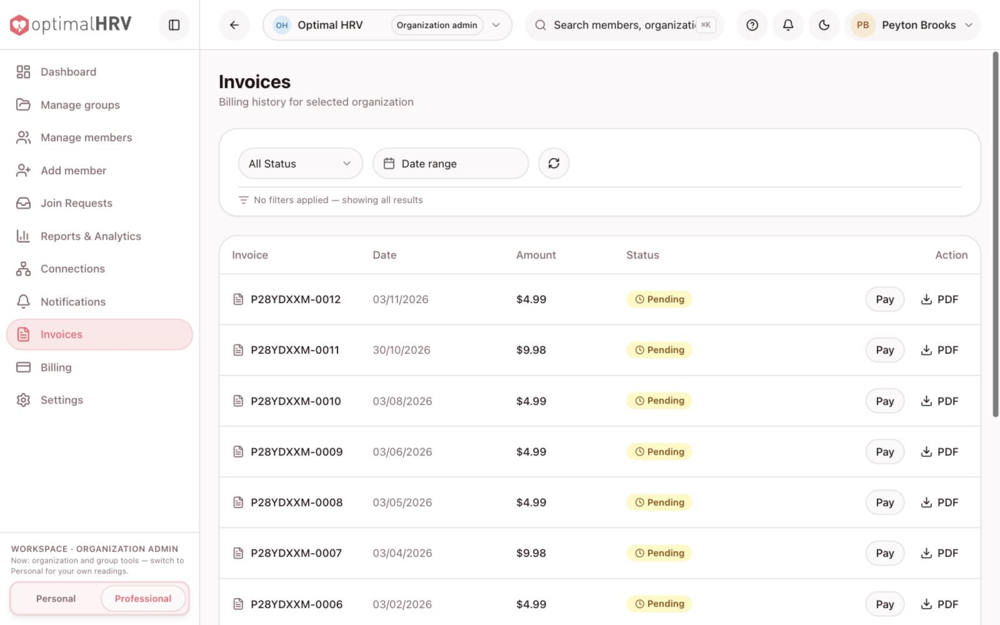
</div>

## 🏢 7: Organizations

### Switch Organizations

If you belong to more than one organization:

- Click the **Organization context** button in the top bar and choose an organization, **or**
- Go to **Connections** and click **Switch** next to the organization you want.

The organization you're currently using is marked **Using now**. Every page, including Dashboard, members, groups, reports, and billing, shows data for that organization only.

### Connections

**Connections** lists every organization you belong to and your role in each. For each one you can:

- **Switch:** Make it your current organization.
- **Manage:** Open its organization page.
- **Groups:** Jump to its groups.

<div align=center>
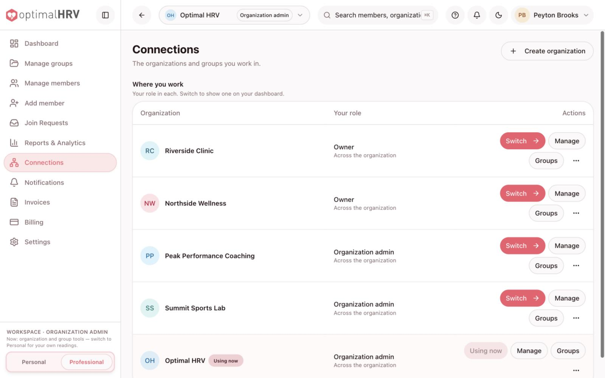
</div>

### Create an Organization

1. Go to **Connections**.
2. Click **Create organization** and fill in the details.

You become the **Owner** of the new organization. If you need help setting up an organization for your team or clinic, email `support@optimalhrv.com`.

### Organization Page and Settings

Open it from **Connections** → **Manage**, or from **Settings** → **Manage organization**. It has these tabs:

- **Overview:** Organization info (name, type, email, phone, website, owner), billing details, and address. Click **Edit** to update them.
- **Groups**, **Users**, **Billing**, **Invoices:** The same tools as the sidebar pages, for this organization.
- **Settings:**
  - **Allow join requests:** Lets people ask to join (for example with a QR code).
  - **Allow self-signup:** Lets people join without an invitation.
  - **Require approval:** An admin must approve new members.

---

## ⚙️ 8: Your Settings and Notifications

### Settings

Open **Settings** from the sidebar:

- **Profile:** Photo, name, phone, date of birth, gender, country, title (Dr., PT, RN, Coach, and so on), and degrees or certifications. Click **Save changes** when you're done.
- **Account:**
  - **Send password reset email:** Get a secure link to choose a new password. Your email address comes from your sign-in provider and can't be changed here.
  - **Refresh app data:** Clears cached charts and data on this device and loads a fresh copy. You stay signed in.
  - **Export my data:** Download your own readings and sessions as a ZIP file.
- **Preferences:** **Dark mode**, **Soft avatar colors**, and **Compact sidebar**.

### Notifications

**Notifications** collects the alerts for the organization or group you're currently viewing:

- **Categories:** **Membership** (join requests and invites), **Health**, **Inactivity**, **Clinical**
- **Status filters:** All, Unread, Read
- **Mark all read** to clear the list

Invites sent to you by other organizations also appear here.

---

## 🎁 9: Activating Lifetime Membership

### Purchase Membership

1. Go to [www.optimalhrv.com](https://www.optimalhrv.com).
2. In the **Best Sellers** section, choose **Lifetime Membership** or **Lifetime Membership + Optimal HRV Reader**.
3. Enter your details (and a delivery address if you're buying the Reader), then complete checkout.

### Claim Membership

1. Look for an email from `support@optimalhrv.com` with a subject starting _"Thank you for purchasing…"_. Check your spam or junk folder if you don't see it.
2. Click **Claim Now** in the email.
3. **Sign in** with your existing account, or **Sign up** for a new one.
4. Check that you're signed in to the right account, then click **Claim Now** to activate the membership.

<div align=center>
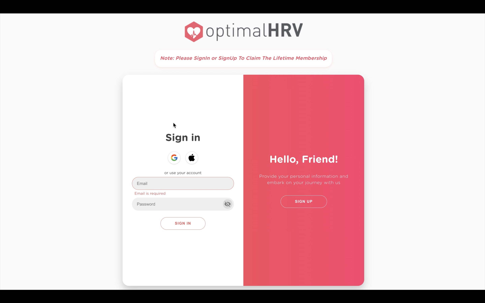
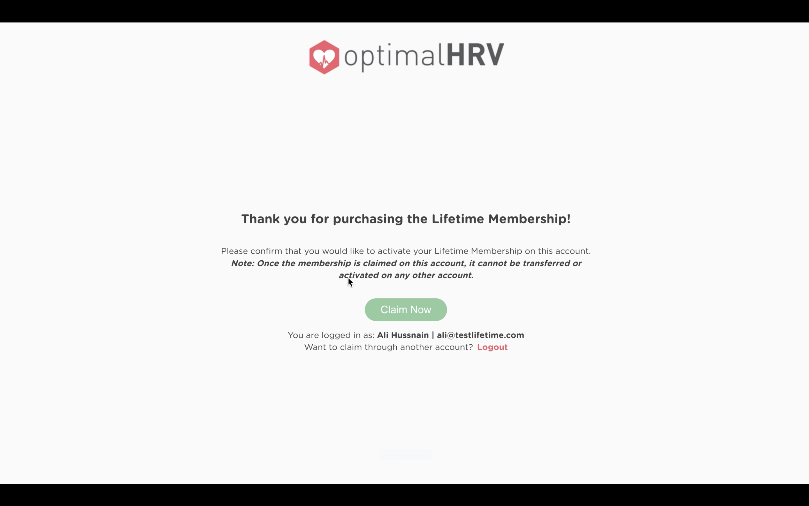
</div>

**Problems?** If the link has expired, contact `support@optimalhrv.com` with your purchase details. If you claimed on the wrong account, sign out and claim again with the right one.

---

## 🔧 10: Troubleshooting

| Problem | What to do |
| --- | --- |
| **I can't see Manage groups, members, or Billing** | Switch to the **Professional** workspace with the toggle at the bottom of the sidebar. If it's still missing, your role may not include that tool (see [Roles](#roles-and-what-they-can-do)). |
| **I'm looking at the wrong organization's data** | Use the **Organization context** button in the top bar, or **Connections** → **Switch**. |
| **"Email already exists" when creating an account** | That person already has an Optimal HRV account. Send them a **QR code or join link** instead. |
| **Someone scanned the QR code but isn't in my organization** | Check **Join Requests**. Approval is on by default, so they're waiting for you to approve them. |
| **A member doesn't appear in a group's reports** | **⋯** → **Edit** → **Assign** tab: make sure the group is selected, then save. |
| **A member shows "Never active" or no data** | They haven't taken a reading or done a session yet. Ask them to sign in to the mobile app with the same email and record a session. |
| **I can't give someone the Organization admin role** | Only someone at a higher level, usually the organization **Owner**, can give a role at your own level. |
| **The billing count looks wrong** | On **Billing**, check **Active members this period** and each member's **Who pays** setting (**⋯** → **Edit** → **Assign**). |
| **Charts look stale** | Click **Refresh** on the page, or go to **Settings** → **Account** → **Refresh app data**. |

### Contact Support

Email `support@optimalhrv.com` and include:

- A screenshot of the problem
- Your role and the organization or group name
- The steps that led to the problem

---

## 📋 Quick Reference

### Common Tasks

| I want to… | Go to |
| --- | --- |
| **Add many people at once** | Manage members → **Add members** → **Share a QR code or join link** → **Generate QR** |
| **Set up one account right now** | Manage members → **Add members** → **Create their account** |
| **Approve people who scanned my code** | **Join Requests** → Approve |
| **Make someone a Group admin** | Manage members → **⋯** → **Edit** → **Assign** → Role |
| **Move someone to another group** | Manage members → **⋯** → **Edit** → **Assign** → Group(s) |
| **Remove someone** | Manage members → **⋯** → **Remove from organization** |
| **Create a group** | Manage groups → **Create Group** |
| **See who needs a check-in** | Dashboard → **Member follow-up** |
| **Look at one person's data** | Click their name anywhere → member profile |
| **Export raw HRV data** | Reports & Analytics → **Export** (or **Export** on a member's profile) |
| **Pay or download an invoice** | **Invoices** → **Pay** / **PDF** |
| **Add a payment card** | **Billing** → **Add card** |
| **Switch organization** | Top-bar **Organization context**, or **Connections** → **Switch** |

### Useful Links

- **Dashboard:** [app.optimalhrv.com](https://app.optimalhrv.com)
- **Support:** `support@optimalhrv.com`
- **Main website:** [www.optimalhrv.com](https://www.optimalhrv.com)
